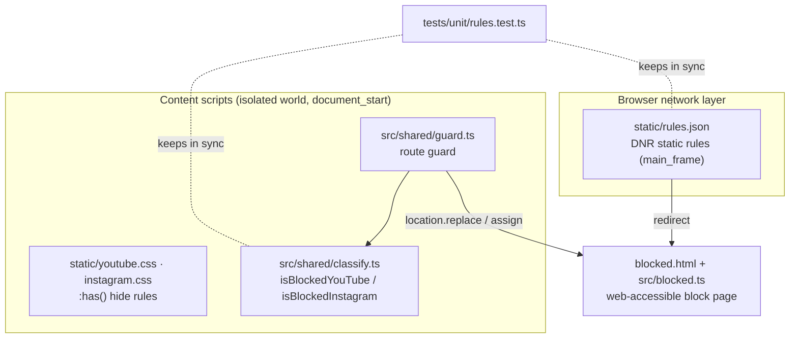
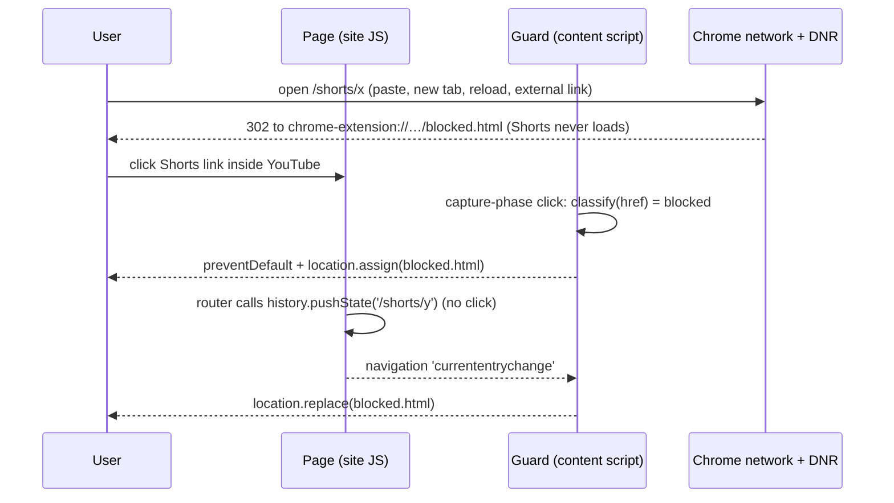

# Architecture

## Stack

| Concern              | Choice                                                                           | Why                                                                        |
| -------------------- | -------------------------------------------------------------------------------- | -------------------------------------------------------------------------- |
| Language             | TypeScript, `strict` + `noUncheckedIndexedAccess` + `exactOptionalPropertyTypes` | Type safety for DOM and URL code                                           |
| Build                | esbuild via `scripts/build.mjs`                                                  | Three IIFE bundles plus a static file copy. No HMR or framework is needed. |
| Unit tests           | Vitest + jsdom                                                                   | Fast. jsdom supports `:has()` for selector tests.                          |
| E2E                  | Playwright, bundled Chromium                                                     | Loads the real unpacked build (branded Chrome dropped `--load-extension`)  |
| Lint/format          | ESLint (typescript-eslint strict) + Prettier                                     |                                                                            |
| Package manager      | npm                                                                              | Ships with Node, has a lockfile, and contributors need no extra tool       |
| Runtime dependencies | none                                                                             |                                                                            |

## Components

| Unit                                    | Responsibility                                                                                                                                |
| --------------------------------------- | --------------------------------------------------------------------------------------------------------------------------------------------- |
| `src/shared/classify.ts`                | Pure URL classification by host allowlist and whole path segments. The single source of truth for routes.                                     |
| `static/rules.json`                     | The same routes as RE2 regexes, for full page loads. It includes an `allow` rule (priority 2) for `/stories/…`.                               |
| `src/shared/guard.ts`                   | Checks the route at start and on every `navigation` `currententrychange`. Intercepts plain left clicks on blocked links in the capture phase. |
| `src/content/{youtube,instagram}.ts`    | Wire the site's classifier into the guard.                                                                                                    |
| `static/{youtube,instagram}.css`        | All hide selectors, each with fixtures in `tests/fixtures/`.                                                                                  |
| `static/blocked.html`, `src/blocked.ts` | The accessible block page. Reads only `?from=<host>`, checked against an allowlist.                                                           |

## Runtime flows

- **`assign` vs `replace`**:
  - A blocked click uses `assign`, so the page the user clicked from stays in history and "Go back" returns to it.
  - A route that is already in history uses `replace`, so the blocked entry disappears and Back cannot loop.
- **Back/Forward**: a traversal fires `currententrychange` for same-document entries. Cross-document entries reload and hit DNR.
- **Modified clicks** (Ctrl/Cmd/Shift/middle) open new tabs, which are full loads blocked by DNR. The guard ignores them.

## Content-script lifecycle

1. Chrome injects `content_scripts.css` "before any DOM is constructed". Hidden surfaces never flash.
2. At `document_start` the guard checks the current URL and registers two listeners. It holds no other state.
3. Nothing needs cleanup. The listeners live as long as the document, and no observer or timer exists.

## Browser APIs and permissions

| API / key                                                                                  | Use                                                                                                             |
| ------------------------------------------------------------------------------------------ | --------------------------------------------------------------------------------------------------------------- |
| `declarativeNetRequestWithHostAccess`                                                      | Static redirect rules. There is no extra install warning beyond the host access.                                |
| `host_permissions`: `www.youtube.com`, `m.youtube.com`, `youtube.com`, `www.instagram.com` | Needed for DNR redirects on those hosts. They match the content-script `matches`.                               |
| `web_accessible_resources`: `blocked.html`                                                 | A DNR redirect target must be web accessible. `use_dynamic_url` breaks DNR `extensionPath` redirects (ADR-005). |
| `navigation` (Navigation API), `chrome.runtime.getURL`                                     | Guard                                                                                                           |

## State

None. No storage, no messaging, no service worker.

## Performance

- Hiding is pure CSS. Every `:has()` is anchored on a specific custom-element tag or on `a[href…]`, never `*:has()`, which keeps style invalidation narrow.
- JS cost per page: one URL parse at start, one per navigation, and one per left click on a link.

## Security

See [SECURITY.md](SECURITY.md) and [PRIVACY.md](PRIVACY.md). Summary:

- No network or remote code.
- The block page treats its only parameter as untrusted.
- The build is not minified, which eases store review.

## Limitations

- **DOM churn**: YouTube and Instagram change their markup. Selectors can stop matching. Mitigations are the fixtures, the `platform-blocking` skill and the live checklist in TESTING.md. Route blocking does not depend on the DOM.
- **English UI**: the YouTube sidebar entry and the channel tab are matched by `title="Shorts"` and `tab-title="Shorts"`. Other UI languages keep those entries visible, but the routes stay blocked.
- **Instagram feed reels**: reels in the home feed may be linked as `/p/{id}` and cannot be told apart from video posts reliably. Their `/reel/` links are hidden and the route is blocked, but the post card can remain.
- **Legacy vanity URLs** (`youtube.com/<name>/shorts`) are not route-blocked. The tab is still hidden.
- **Detectability**: `blocked.html` is web-accessible to the two sites, so those sites could detect that the extension is installed.
