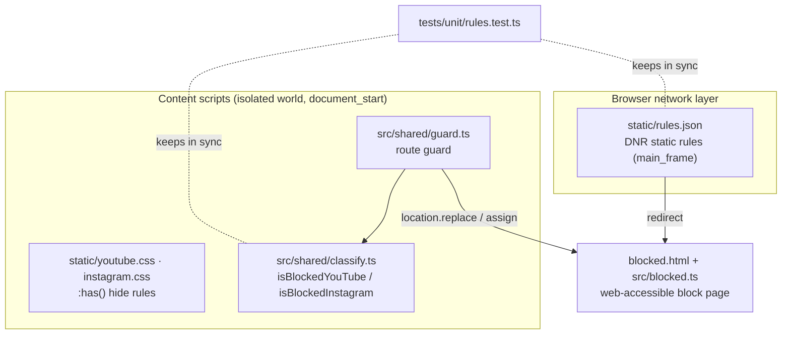
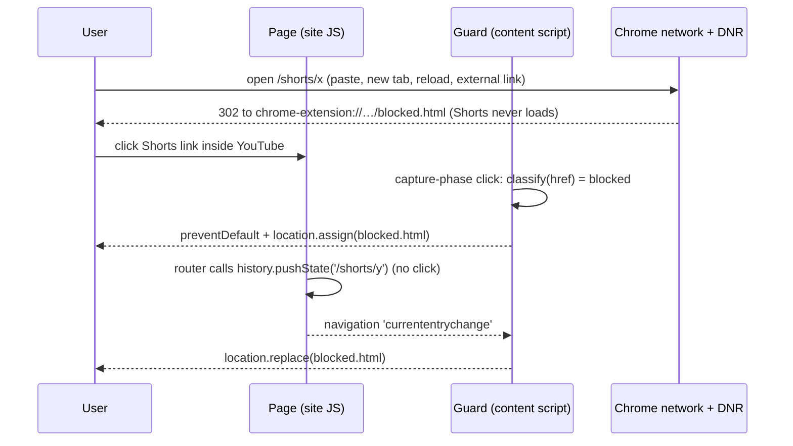

# Architecture

## Stack

| Concern              | Choice                                                                           | Why                                                                        |
| -------------------- | -------------------------------------------------------------------------------- | -------------------------------------------------------------------------- |
| Language             | TypeScript, `strict` + `noUncheckedIndexedAccess` + `exactOptionalPropertyTypes` | Type safety for DOM and URL code                                           |
| Build                | esbuild via `scripts/build.mjs`                                                  | Three IIFE bundles plus a static file copy. No HMR or framework is needed. |
| Unit tests           | Vitest + jsdom                                                                   | Fast. jsdom supports `:has()` for selector tests.                          |
| E2E                  | Playwright, bundled Chromium                                                     | Loads the real unpacked build (branded Chrome dropped `--load-extension`)  |
| Lint/format          | ESLint (typescript-eslint strict) + Prettier                                     |                                                                            |
| Package manager      | npm                                                                              | Ships with Node, has a lockfile, and contributors need no extra tool       |
| Runtime dependencies | none                                                                             |                                                                            |

## Components

| Unit                                                          | Responsibility                                                                                                                                |
| ------------------------------------------------------------- | --------------------------------------------------------------------------------------------------------------------------------------------- |
| `src/shared/classify.ts`                                      | Pure URL classification by host allowlist and whole path segments. The single source of truth for routes.                                     |
| `static/rules.json`                                           | The same routes as RE2 regexes, for full page loads. It includes an `allow` rule (priority 2) for `/stories/…`.                               |
| `src/shared/guard.ts`                                         | Checks the route at start and on every `navigation` `currententrychange`. Intercepts plain left clicks on blocked links in the capture phase. |
| `src/content/{youtube,instagram}.ts`                          | Wire the site's classifier into the guard.                                                                                                    |
| `static/{youtube,instagram}.css`                              | All hide selectors, each with fixtures in `tests/fixtures/`.                                                                                  |
| `src/shared/settings.ts`, `src/popup.ts`, `static/popup.html` | Toggle defaults, storage access, toolbar popup.                                                                                               |
| `src/content/suggested.ts`                                    | Tags Instagram feed posts from unfollowed accounts (in-post "Follow" button).                                                                 |
| `static/blocked.html`, `src/blocked.ts`                       | The accessible block page. Reads only `?from=<host>`, checked against an allowlist.                                                           |

## Runtime flows

- **`assign` vs `replace`**:
  - A blocked click uses `assign`, so the page the user clicked from stays in history and "Go back" returns to it.
  - A route that is already in history uses `replace`, so the blocked entry disappears and Back cannot loop.
- **Back/Forward**: a traversal fires `currententrychange` for same-document entries. Cross-document entries reload and hit DNR.
- **Modified clicks** (Ctrl/Cmd/Shift/middle) open new tabs, which are full loads blocked by DNR. The guard ignores them.

## Content-script lifecycle

1. Chrome injects `content_scripts.css` "before any DOM is constructed". Hidden surfaces never flash.
2. At `document_start` the guard checks the current URL and registers two listeners. It holds no other state.
3. Nothing needs cleanup. The listeners live as long as the document.
4. Instagram only: the content script sets attributes on `<html>`: `data-rsb-home` (route is `/`), and `data-rsb-hide-feed-reels` / `data-rsb-followed-only` (toggles). The defaults apply first, then the stored values, then live updates through `chrome.storage.onChanged`. CSS rules in `instagram.css` are scoped by these attributes, so toggling needs no reload.
5. While "Only show accounts I follow" is on, `src/content/suggested.ts` runs one MutationObserver (childList, subtree, characterData). It rescans the 5–9 virtualized feed `article`s once per animation frame and tags posts that contain a `Follow` button with `data-rsb-suggested`. Turning the toggle off disconnects it and removes the tags (ADR-011).

## Browser APIs and permissions

| API / key                                                                                  | Use                                                                                                             |
| ------------------------------------------------------------------------------------------ | --------------------------------------------------------------------------------------------------------------- |
| `declarativeNetRequestWithHostAccess`                                                      | Static redirect rules. There is no extra install warning beyond the host access.                                |
| `host_permissions`: `www.youtube.com`, `m.youtube.com`, `youtube.com`, `www.instagram.com` | Needed for DNR redirects on those hosts. They match the content-script `matches`.                               |
| `web_accessible_resources`: `blocked.html`                                                 | A DNR redirect target must be web accessible. `use_dynamic_url` breaks DNR `extensionPath` redirects (ADR-005). |
| `navigation` (Navigation API), `chrome.runtime.getURL`                                     | Guard                                                                                                           |

## State

Two booleans in `chrome.storage.sync` (`src/shared/settings.ts`): `igHideFeedReels` and `igFollowedOnly`, both default `true`. They are edited by the toolbar popup (`static/popup.html`, `src/popup.ts`). There is no messaging and no service worker. Content scripts read the storage directly.

## Performance

- Hiding is pure CSS. Every `:has()` is anchored on a specific custom-element tag or on `a[href…]`, never `*:has()`, which keeps style invalidation narrow.
- JS cost per page: one URL parse at start, one per navigation, and one per left click on a link.

## Security

See [SECURITY.md](SECURITY.md) and [PRIVACY.md](PRIVACY.md). Summary:

- No network or remote code.
- The block page treats its only parameter as untrusted.
- The build is not minified, which eases store review.

## Limitations

- **DOM churn**: YouTube and Instagram change their markup. Selectors can stop matching. Mitigations are the fixtures, the `platform-blocking` skill and the live checklist in TESTING.md. Route blocking does not depend on the DOM.
- **English UI**: the YouTube sidebar entry and the channel tab are matched by `title="Shorts"` and `tab-title="Shorts"`. Other UI languages keep those entries visible, but the routes stay blocked.
- **Instagram feed filters**:
  - Feed reels are detected by their `/reels/{id}/` media link wrapping a `<video>`. With "Hide reels" off, reels play inline in the feed, but opening one still shows the block page.
  - Suggested posts are detected by the English "Follow" button text. In other UI languages, suggested posts stay visible. Ads are detected structurally (no `<time>`) in any language.
  - Opening a reel through a `/p/{id}/` link (Explore, shared links) shows it, because `/p/` also serves photo posts. Explore and profile tiles are hidden by their "Reel"/"Clip" icon labels (English UI).
- **Legacy vanity URLs** (`youtube.com/<name>/shorts`) are not route-blocked. The tab is still hidden.
- **Detectability**: `blocked.html` is web-accessible to the two sites, so those sites could detect that the extension is installed.
